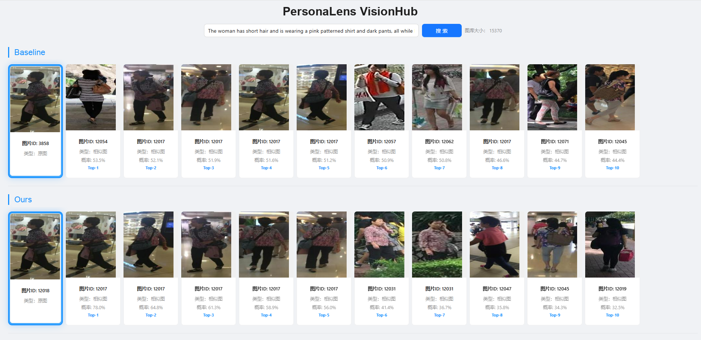
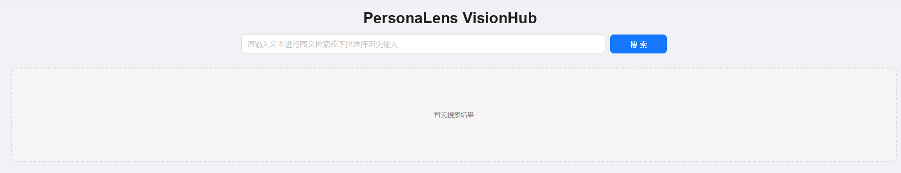

<h1 align="center">PersonaLens VisionHub</h1>

<p align="center"><strong>行人图文检索与可视化系统</strong></p>

<p align="center">以描述连接图像，让检索一目了然。</p>

<p align="center">
  Describe · Retrieve · Compare · Inspect
</p>

<p align="center">
  
  
  
  
</p>

<p align="center">
  <a href="#系统预览">系统预览</a> ·
  <a href="#功能特性">功能特性</a> ·
  <a href="#运行准备">运行准备</a> ·
  <a href="#快速开始">快速开始</a> ·
  <a href="#使用指南">使用指南</a> ·
  <a href="#部署与访问">部署与访问</a> ·
  <a href="#接口说明">接口说明</a> ·
  <a href="#常见问题">常见问题</a>
</p>

**PersonaLens VisionHub** 是一套面向行人图库的图文检索与可视化系统，将描述输入、检索请求、结果对照和图片浏览整合到同一界面。系统当前接入 **Baseline** 与 **Ours** 两路结果，支持同屏查看原图、相似图片、排名与分数。

它关注的是清晰、直观的系统体验：输入一段描述，等待结果返回，再通过图片预览与分组对照查看细节。

## 系统预览

### 检索结果界面

[](images/retrieval-results.png)

<p align="center"><strong>Baseline</strong> 在上，<strong>Ours</strong> 在下。点击图片可查看查询原图、相似图片与结果细节。</p>

<p align="center"><sub>系统运行示例，不作为定量性能评测；公开展示或发布图片前需确认相应图像授权。</sub></p>

### 检索首页

[](images/home-page.png)

搜索框是系统的主要入口。输入英文行人描述后，页面按结果来源分组展示内容，并通过高亮边框区分查询原图与相似图片。

## 功能特性

| 功能 | 系统体验 |
| --- | --- |
| **描述输入** | 使用英文行人描述发起检索，支持输入校验与加载状态 |
| **同屏对照** | 在一个页面中查看 Baseline 与 Ours 两组结果，无需来回切换 |
| **Top-10 展示** | 返回最多 10 张相似图片，同时展示排名、标识与分数 |
| **原图高亮** | 将查询原图置于结果前，使用独立边框标记 |
| **大图预览** | 点击图片放大，便于查看服饰、携带物等细节 |
| **历史输入** | 在浏览器本地保存最近 5 条描述，支持下拉选择 |
| **自适应布局** | 图片网格适配不同窗口宽度，兼顾桌面与较窄屏幕 |
| **独立接口** | 通过 HTTP JSON 接口访问检索服务，前后端可分开运行 |

### 使用流程

1. **Describe** — 输入当前图库中可用的英文描述。
2. **Retrieve** — 点击搜索，等待两路请求依次完成。
3. **Compare** — 对照分组结果、原图与 Top-10 排名。
4. **Inspect** — 点击图片查看细节，或从历史输入中再次检索。

### 当前版本范围

PersonaLens VisionHub 当前用于已有图库与描述索引的检索展示。

- 支持已接入数据的描述匹配、图片浏览和结果对照。
- 不支持任意新文本直接检索。
- 页面暂不提供图片上传、图库增删或结果下载按钮。
- 暂不包含账号、权限管理、任务队列和并发隔离。

## 阅读路线

| 你的目标 | 建议阅读 |
| --- | --- |
| 先了解系统 | [系统预览](#系统预览) → [功能特性](#功能特性) |
| 在本机运行 | [运行准备](#运行准备) → [快速开始](#快速开始) |
| 从其他设备访问 | [部署与访问](#部署与访问) |
| 接入自己的页面或服务 | [接口说明](#接口说明) |
| 排查运行问题 | [常见问题](#常见问题) |

## 运行准备

### 环境要求

| 组件 | 要求 |
| --- | --- |
| Python | 3.8，后端环境文件的参考版本 |
| 后端依赖 | Flask、Flask-Cors，以及环境配置中列出的运行依赖 |
| 推理环境 | NVIDIA GPU，以及兼容的 CUDA 版 PyTorch / torchvision |
| Node.js | 建议 22.12+，或其他满足 Vite 7 要求的兼容版本 |
| npm | 用于安装依赖和构建前端 |
| 操作系统 | Linux；Windows 需要使用对应平台的软件包与运行环境 |

> 当前后端不提供 CPU 推理回退。环境文件包含平台相关依赖，跨系统安装时可能需要调整对应软件包。

### 服务资源

运行前需要单独准备与服务匹配的图库、描述索引、样本标注和推理资源。它们不包含在源码仓库中。

| 资源 | 用途 |
| --- | --- |
| 行人图库 | 提供查询原图和结果图片 |
| 描述索引 | 用于匹配页面输入的描述 |
| 样本标注 | 建立描述、图像路径和数据标识之间的对应关系 |
| 推理资源 | 供后端检索服务加载使用 |
| 日志目录 | 保存服务运行时的诊断信息 |

具体位置见 [Ours 运行配置](flask/test_config.py)与 [Baseline 运行配置](flask/CFine/test_config.py)。两路服务分别读取各自的资源，请确认文件完整、版本匹配且路径可访问。

### 启动前检查

- [ ] 后端终端使用正确的 Python 解释器，GPU 可用。
- [ ] 图库、描述索引、样本标注和推理资源准备完整。
- [ ] 两路服务的资源路径与运行配置一致。
- [ ] 日志目录存在且可写。
- [ ] 前端接口地址可以从浏览器所在机器访问。

## 快速开始

以下命令未特别说明时，均从项目根目录执行。已有可用后端环境时，可以跳过环境创建，直接激活自己的环境。

### 1. 创建后端环境

```bash
conda env create --name personalens --file flask/environment.yml
conda activate personalens
python -m pip install Flask Flask-Cors
```

环境文件中的 PyTorch、torchvision 安装项被注释，需要根据 Python 和 CUDA 版本[另行安装](https://pytorch.org/get-started/previous-versions/)。该环境文件是依赖参考，不保证直接适用于所有系统。

检查解释器与 GPU：

```bash
python -c "import sys; print(sys.executable)"
python -c "import torch; print('CUDA available:', torch.cuda.is_available())"
```

确认 `CUDA available` 为 `True`，并完成服务资源准备。

### 2. 启动后端

```bash
cd flask
conda activate personalens
python -c "from pathlib import Path; Path('checkpoints/best_model/logs').mkdir(parents=True, exist_ok=True)"
python app.py
```

默认接口地址：

```text
http://127.0.0.1:4523/api/v1
```

保持该终端运行。上面的命令创建了默认日志目录；其他已接入服务的日志目录也应按其运行配置准备。

### 3. 配置前端

另开一个终端，从项目根目录进入前端：

```bash
cd frontend
cp .env.example .env.local
```

Windows PowerShell 可使用：

```powershell
Copy-Item .env.example .env.local
```

编辑 `.env.local`：

```dotenv
VITE_API_BASE_URL=http://127.0.0.1:4523/api/v1
```

### 4. 打开系统

在 `frontend/` 下执行：

```bash
npm install
npm run dev
```

打开 Vite 输出的页面地址，通常为 `http://localhost:5173`。前后端需要分别保持运行。

## 使用指南

### 发起检索

1. 在搜索框中输入英文行人描述。
2. 点击“搜索”，按钮进入加载状态。
3. 等待 Baseline 与 Ours 两路请求依次返回。
4. 查看分组结果，点击图片放大浏览。

首次验证时，建议从本地已有描述中选择输入，并确认对应图片包含在已接入的样本索引中。下面的自编句子只说明输入格式，不保证命中当前数据：

```text
A pedestrian in a navy coat and cream trousers carries an orange tote bag.
```

<details>
<summary><strong>如何从本地数据选择一条可用描述</strong></summary>

以下 Python 代码适用于默认资源路径，只读取本地文件，不上传或下载数据。从项目根目录执行；自定义部署请调整对应路径。

```python
import json
from pathlib import Path

annotation_path = Path("flask/cuhkpedes/preprocessed_samples/test_reid.json")
caption_path = Path("flask/data/CUHK-PEDES/caption_all.json")
samples = json.loads(annotation_path.read_text(encoding="utf-8"))
records = json.loads(caption_path.read_text(encoding="utf-8"))
eligible_paths = {item["file_path"] for item in samples}

for item in records:
    if item["file_path"] in eligible_paths and item.get("captions"):
        print(item["captions"][0])
        break
else:
    raise RuntimeError("未找到可用描述，请核对描述索引与样本标注。")
```

将输出的描述复制到页面搜索框即可。

</details>

### 阅读结果

| 展示项 | 含义 |
| --- | --- |
| **Baseline / Ours** | 当前结果的来源分组 |
| **高亮原图** | 当前查询关联的原图 |
| **图片标识** | 来自数据标注或结果文件的标识，不保证是全局唯一图片编号 |
| **Top-k** | 当前分组内的结果顺序 |
| **分数** | 检索相似度，不是人物身份确认概率 |
| **搜索历史** | 当前浏览器中保存的最近 5 条输入 |

当前界面将分数显示为百分数并标注为“概率”，应将其理解为相似度。系统展示的图片和排名不构成人物身份确认结论。

### 复用历史输入

搜索框会在本地浏览器中保存最近 5 条描述。可从下拉列表选择历史输入，避免重复键入。历史保存在当前浏览器的本地存储中，不是跨设备同步记录。

### 描述格式参考

以下句子为自编格式示例，不是随仓库发布的数据标注，也不保证能直接检索。实际使用时，请选择本地已有的可用描述。

<details open>
<summary><strong>查看 10 条英文描述示例</strong></summary>

1. A pedestrian in a navy coat and cream trousers carries an orange tote bag.

2. An adult in a gray hoodie wears black shorts and white trainers.

3. A person in an olive jacket and dark jeans carries a small shoulder bag.

4. A pedestrian wears a long beige coat, navy trousers, and brown shoes.

5. A person in a red sweater wears a denim skirt and white canvas shoes.

6. An adult in a black windbreaker and green shorts carries a backpack.

7. A person wearing a white cap and blue T-shirt holds a folded umbrella.

8. An adult in a purple cardigan and gray trousers carries a light brown bag.

9. A pedestrian wears a striped shirt, black trousers, and dark running shoes.

10. An adult in a light blue jacket and tan trousers carries a reusable shopping bag.

</details>

## 部署与访问

### 开发与静态预览

| 服务 | 默认端口 | 说明 |
| --- | --- | --- |
| 前端开发服务器 | `5173` | 实际地址以 Vite 终端输出为准 |
| 前端静态预览 | `4522` | 可在启动命令中调整 |
| 后端接口 | `4523` | 与前端接口地址保持一致 |

需要从其他电脑访问开发页面时，在 `frontend/` 下执行：

```bash
npm run dev -- --host 0.0.0.0
```

生成静态页面并预览：

```bash
npm run build
npx serve -s dist -l 4522 --no-clipboard
```

本机访问 `http://localhost:4522`；远程使用前端服务器的可达地址。

### 接口地址配置

| 场景 | 设置方式 |
| --- | --- |
| 浏览器与后端在同一台机器 | 可使用 `http://127.0.0.1:4523/api/v1` |
| 从其他电脑访问 | 将 `127.0.0.1` 替换为浏览器可达的后端 IP 或域名 |
| 使用端口转发或反向代理 | 使用实际对外地址与正确的 API 路径 |
| 页面使用 HTTPS | 配置兼容的 HTTPS 接口，避免混合内容被拦截 |

- `0.0.0.0` 是监听地址，不应直接作为浏览器访问地址。
- 页面地址与接口地址相互独立，能打开页面不代表后端已经可达。
- 修改 `.env.local` 后，重启开发服务器，或重新构建静态页面。
- `VITE_` 前缀变量会进入前端构建产物，不应存放访问密钥。

### 访问边界

当前服务面向本地或受控网络中的演示使用，不包含账号与权限管理。后端默认调试模式和跨域设置不适合未经加固直接暴露到公网。

多用户公开部署前，需要增加访问控制、关闭调试模式、限制跨域来源，并处理共享查询文件和结果目录的并发隔离。当前版本建议串行检索。

## 接口说明

### 请求

```http
POST /api/v1/images_text_retrieval
Content-Type: application/json
```

```json
{
  "search": "A pedestrian in a navy coat and cream trousers carries an orange tote bag.",
  "model": "Ours"
}
```

| 参数 | 类型 | 说明 |
| --- | --- | --- |
| `search` | string | 必填，输入描述；实际调用时替换为本地数据中可用的描述 |
| `model` | string | 必填，选择 `Baseline` 或 `Ours` 检索通道 |

页面会分别请求两个通道。通过接口接入其他应用时，也可以只指定其中一个。

### 响应

以下为响应结构示意，图片内容已省略：

```json
{
  "query_imgs": [
    {
      "id": 123,
      "score": 1.0,
      "pic": "data:image/jpeg;base64,...",
      "is_query": true
    },
    {
      "id": 456,
      "score": 0.85,
      "pic": "data:image/jpeg;base64,...",
      "is_query": false
    }
  ],
  "gallery_size": 15370
}
```

| 字段 | 说明 |
| --- | --- |
| `query_imgs` | 查询原图及最多 10 张结果图 |
| `id` | 数据标识 |
| `score` | 相似度；查询原图固定为 `1.0` |
| `pic` | 可以直接用于图片组件的 Data URI |
| `is_query` | 是否为查询原图 |
| `gallery_size` | 当前代码固定返回 `15370`，不代表实际接入图库的唯一图片数量 |

成功响应还可能包含 `debug_info`；失败响应包含 `error` 等信息。

### 常见状态码

| 状态码 | 含义 |
| --- | --- |
| `200` | 请求处理完成 |
| `400` | 缺少参数或通道标识不支持 |
| `404` | 描述未命中，或相关数据未找到 |
| `500` | 文件、配置或检索处理异常 |
| `504` | 检索子进程超时 |

## 项目结构

```text
.
├── README.md
├── flask/
│   ├── app.py                 # HTTP 检索接口
│   ├── config.py              # 运行配置工具
│   ├── test_config.py         # 检索服务参数
│   └── environment.yml        # 后端环境参考
├── frontend/
│   ├── src/pages/             # PersonaLens VisionHub 页面
│   ├── src/components/        # 搜索框、结果网格与图片预览
│   ├── src/service/           # 接口请求
│   ├── src/types/             # 前端数据类型
│   ├── .env.example           # 环境变量示例
│   └── package.json
└── images/                    # 系统界面截图
```

前端常用命令，在 `frontend/` 下执行：

```bash
npm run dev       # 开发服务器
npm run lint      # 静态检查
npm run build     # 类型检查与构建
npm run preview   # 预览构建产物
```

## 常见问题

<details>
<summary><strong>页面打开了，但搜索失败</strong></summary>

检查后端终端、浏览器 Network 面板中的请求地址与状态码，以及 `VITE_API_BASE_URL`、防火墙和安全组。修改配置后，重启开发服务器或重新构建静态页面。

</details>

<details>
<summary><strong>输入了一句新描述，为什么没有结果</strong></summary>

当前系统匹配已接入数据中的已有描述，不支持任意新句直接检索。首次验证请使用本地可用描述，并确认对应样本已经包含在服务索引中。

</details>

<details>
<summary><strong>为什么只显示一组结果</strong></summary>

前端允许一路请求失败后继续展示另一组结果。检查缺失通道对应的请求、资源和日志，不要将部分成功误认为两路均已成功。

</details>

<details>
<summary><strong>检索需要等待较长时间</strong></summary>

当前服务会在请求处理中加载资源并执行检索，耗时取决于设备、数据规模和运行配置。请保持后端运行，等待当前请求结束后再发起下一次查询。

</details>

<details>
<summary><strong>GPU 不可用，或者出现资源加载错误</strong></summary>

使用 `nvidia-smi` 和 `torch.cuda.is_available()` 检查设备及环境；核对服务资源是否完整、配置是否匹配、相关文件和日志目录是否可访问。

</details>

<details>
<summary><strong>本机能访问，其他电脑无法访问</strong></summary>

前端开发服务器需要监听可达的网络地址；后端接口地址不能填写客户端自己的 `127.0.0.1`。还要检查页面端口、接口端口、防火墙、安全组及 HTTPS 配置。

</details>

<details>
<summary><strong>端口被占用</strong></summary>

Linux 可执行：

```bash
lsof -i :4522
lsof -i :4523
```

Windows 可执行：

```powershell
netstat -ano | findstr :4522
netstat -ano | findstr :4523
```

确认进程用途后，优先在原终端使用 `Ctrl+C` 停止，或更换端口。修改后端端口时，同步更新前端接口地址。

</details>
